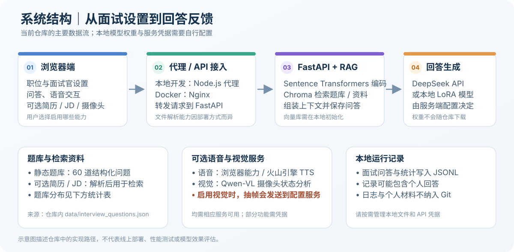

# 智能面试助手

一个用于求职练习的 AI 模拟面试网页。项目包含职位面试题库、向量检索与 RAG、语音交互、可选的简历检索、摄像头状态分析、面试日志，以及 LoRA 训练脚本。

## 系统结构

<p align='center'>
  
</p>

系统图对应仓库当前实现；摄像头分析、第三方语音服务为可选项。启用 Qwen-VL 摄像头分析时，抽取的画面会发送到配置的服务。

## 功能与运行边界

| 模块 | 当前实现 | 运行说明 |
| --- | --- | --- |
| 面试题库 | 5 类职位，共 60 道结构化问题 | 题目数量和分布见下表 |
| 检索增强 | Sentence Transformers + Chroma；支持将简历内容用于检索 | 向量库需在本地初始化；检索效果尚无基准测试数据 |
| 回答生成 | DeepSeek API 或本地 LoRA 模型 | API 凭据需自行配置；LoRA 权重不包含在仓库中 |
| 语音交互 | 浏览器语音能力，可选火山引擎 TTS | 第三方 TTS 需要服务端凭据 |
| 摄像头分析 | 可选 Qwen-VL 表情与姿态分析 | 开启后摄像头抽帧会发送到配置的 Qwen-VL 服务 |
| 面试记录 | 本地 JSONL 问答与统计日志 | 可能包含个人回答，日志目录不会提交到 Git |

## 题库数据概览

| 职位方向 | 题数 | 占比 |
| --- | ---: | ---: |
| 软件工程师 | 22 | 36.7% |
| 产品经理 | 12 | 20.0% |
| UI/UX 设计师 | 7 | 11.7% |
| 市场营销 | 8 | 13.3% |
| 数据分析师 | 11 | 18.3% |
| **合计** | **60** | **100%** |

难度分布：简单 18 道 · 中等 28 道 · 困难 14 道。

> 统计来源：仓库内的 [面试题库文件](data/interview_questions.json)。这些数字只描述当前静态题库，不代表模型准确率、面试通过率或第三方评估结果。

## 项目结构

```text
backend/       FastAPI、RAG、向量存储、语音与视觉接口
data/          面试题库；向量数据库和个人面试日志不提交
docker/        Docker 前端、后端镜像配置及 Nginx 配置
scripts/       向量库初始化与 LoRA 训练脚本
index.html     网页入口
script.js      页面交互与面试流程
proxy.js       本地开发代理和 PDF/Word 文本解析
```

模型权重、Python 虚拟环境、Node 依赖、运行日志、个人报告和演示文件已从 Git 跟踪范围中排除。LoRA 权重可按需放入 `models/lora-interview/merged/`；不会随仓库下载。

## 本地启动

需要 Python 3.10+、Node.js 18+。首次启动向量库时会下载多语言 Sentence Transformers 模型。

1. 安装依赖并准备服务端配置：

   ```bash
   python3 -m venv .venv
   source .venv/bin/activate
   pip install -r backend/requirements.txt
   npm install
   cp .env.example .env
   ```

2. 在 `.env` 中填写需要使用的 API 凭据。DeepSeek 用于在线面试生成；Qwen-VL 和火山引擎 TTS 为可选能力。不要把 `.env` 提交到 Git。

3. 在一个终端启动 Python 后端：

   ```bash
   python backend/main.py
   ```

4. 在另一个终端加载 `.env` 并启动本地代理：

   ```bash
   set -a
   source .env
   set +a
   node proxy.js
   ```

5. 浏览器访问 `http://localhost:8866`。

## Docker

在 `.env` 中设置服务端凭据后运行：

```bash
docker compose up --build
```

网页地址为 `http://localhost:8866`。当前 Docker Nginx 配置没有接入 `proxy.js` 的 `/parse-file` 路由，因此 Docker 模式下简历/JD 文件解析暂不可用；本地 Node 代理模式支持该路由。

## LoRA 训练

安装 `requirements-train.txt` 后运行：

```bash
python scripts/lora_train.py \
  --model Qwen/Qwen2.5-1.5B-Instruct \
  --output models/lora-interview \
  --epochs 3 \
  --merge-weights
```

训练和合并后的权重较大，默认由 `.gitignore` 排除。训练脚本支持 CUDA、Apple MPS 和 CPU；CPU 训练会较慢。

## 配置说明

- `DEEPSEEK_API_KEY`、`QWEN_API_KEY`、`VOLC_APP_ID` 和 `VOLC_TOKEN` 都只在服务端读取。
- 若本地 LoRA 模型没有加载成功，当前 RAG 后端会退回 DeepSeek API，因此选择本地模型并不自动保证完全离线。
- 面试日志可能包含问题、回答和评分；`data/interview_logs/` 不会提交。
